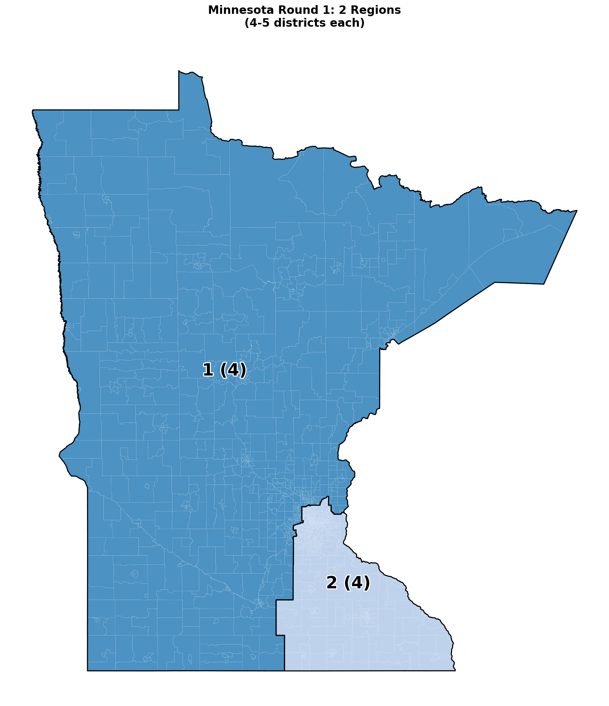
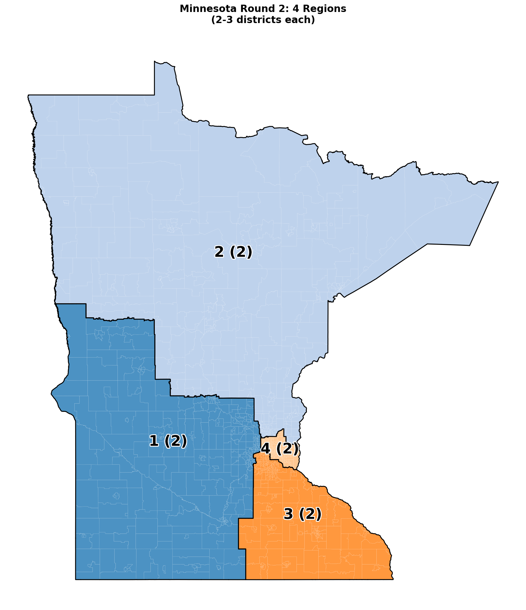
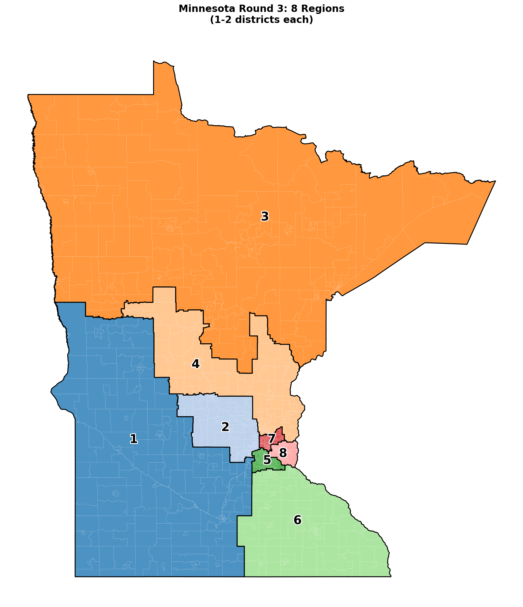
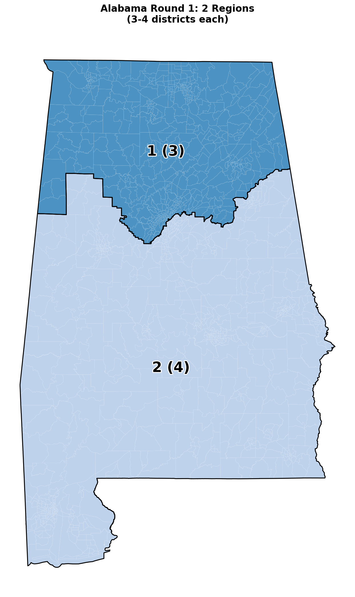
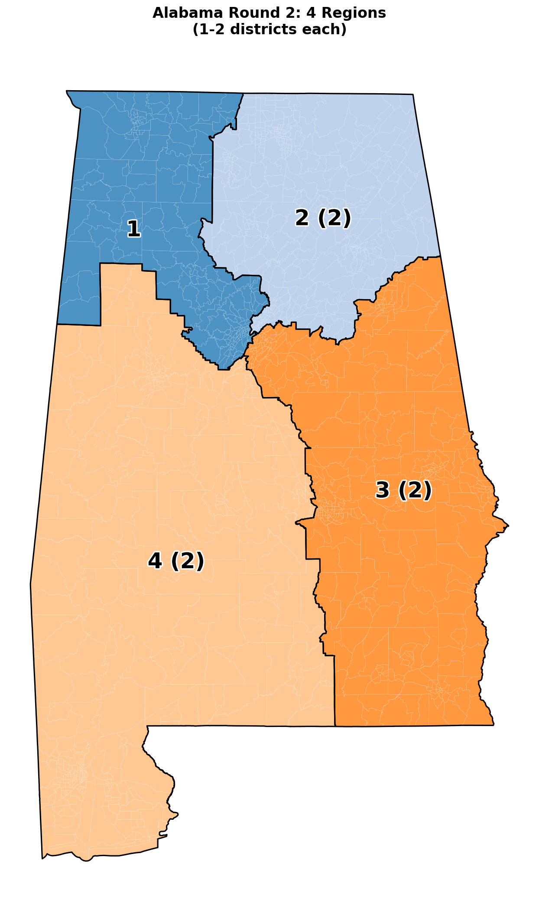
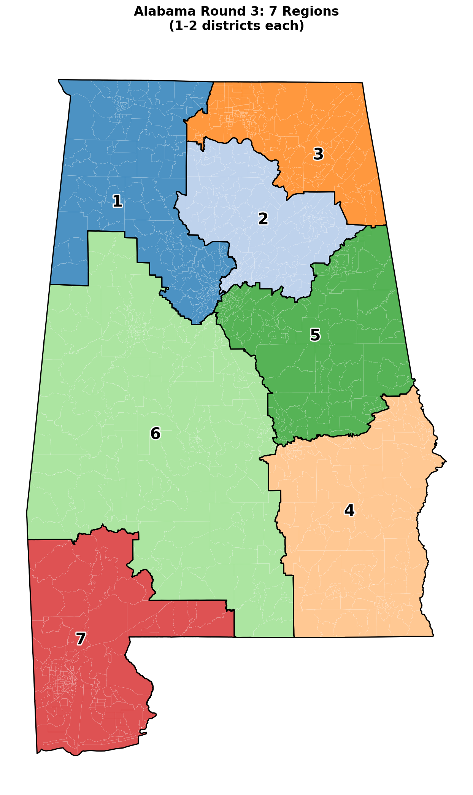

# bisect — Algorithmic Redistricting

The current WASM candidate adds explicit x86 sampling, municipal split counts,
and native Compare exports. The evidence and limits are listed in
[the current candidate checkpoint](docs/specs/wasm-current-amendment-evidence.md).
The full release and original desktop parity plan remain open.

The local workbench now has a desktop-style `civic_inputs` folder picker
alongside the recursive collection picker. Compare also supports the tested
California and Texas block-ID assignment files. Both browser profiles matched
the desktop exports and reopened saved work without running it. See the
[parity ledger](docs/specs/wasm-parity-ledger.md) for scope and evidence.

The local workbench also runs desktop Civic Conflicts on normalized CSVs
you select under ordered labels, with an exact desktop JSON export. Opening
a project restores the files for review and requires an explicit rerun.
Large saves can use the existing gzip format when it reduces the file size.
In both browser profiles, the retained 50-state project saved as 24.8 MB
instead of 132.9 MB and reopened without starting a run.

Candidate-race packages use the desktop state and year label when the label
field is blank. A supplied label still overrides it. You can save the selected
CSV and attestation files locally and rerun explicitly after reopening.
With browser folder access, you can also review and write the package under
`<version>/civic_inputs/<label>/` in the output folder you select. Replacement
requires confirmation, and a receipt records files checked after writing.

Native backend profile correction (2026-11-05): the isolated corrected WASM
passes 192 original backend/fallback comparisons and 18 actual browser journeys.
Fresh State separates the native build profile from algorithm flags and C-runtime
loading; methods that do not use METIS need no C runtime. Maintained runtime
and browser regressions are integrated locally with standard/C builder gates.
Full amended build and original WP-01–WP-10 acceptance remain pending. See the
[fresh-input guide](docs/specs/wasm-fresh-native-state.md).


Current WASM checkpoint (2026-11-03): selected native64 multiscale runs and explicit
fresh-run audit/analysis/improvement handoffs are integrated locally. Additional
full-state checks match the desktop State CLI for NC (2,672 tracts/14 districts)
and CA (9,129/52), with requested seed42, native retries and the original0.5%
tolerance. Both browser profiles pass complete maps and explicit native audits;
NC saves/restores ordinary projects and autosave, while CA uses the existing
large-workbench archive path. Imported results remain unverified. A bounded
retained-view parser fixes CA archive viewing without changing ordinary project
limits. See [fresh State inputs](docs/specs/wasm-fresh-native-state.md). Full
WP-01–WP-10/release acceptance remains open; no new deployment is claimed.


Fresh State follow-ups (integrated locally, 2026-11-03): current fresh
ordinary/multiscale runs can explicitly select their exact native plan/context
for audit, analysis or improvement, then Execute separately. Saved results remain
unverified and cannot activate these controls. Both Chrome profiles pass seven
workflows and 21 complete native-host comparisons. See
[the follow-up guide](docs/specs/wasm-fresh-native-followups.md). Full amended
release acceptance remains open.

Fresh State weighting inputs also accept original partisan, demographic, economic
and housing files alongside COI. Native flags choose which sources are consumed;
selecting a file alone does not activate a weighting mode. Review/Run, Save/Open
and projects preserve the raw bytes. See
[selected auxiliary files](docs/specs/wasm-fresh-native-auxiliary-inputs.md) for
formats, limits and tested scope. Scoped acceptance records cover standalone
reset, Config Validate, Config New creation and selected-root YAML publication.
They preserve original input/output bytes and interruption evidence; complete
parent and desktop parity, actual OS folder grants and release sign-off remain open.

**Series:** [Election Systems](https://github.com/giodl73-repo/giodl73-repo/blob/main/series/election-systems.md).

**Review roles:** This repo uses
[ROLES](https://github.com/giodl73-repo/ROLES), the `.roles` convention for
repository-local review panels.

## Show someone (start here)

New computer or removable data drive: [portable data setup](docs/PORTABLE_DATA.md).
Editable maps and offline atlas packages: [QGIS publication pilot](docs/PUBLICATION_QUICKSTART.md).

Hand the repo to an election researcher or an algorithm implementer without a
maintainer tour:

| Audience | Path | Time |
|---|---|---|
| **Election researcher / journalist** | [SHOWCASE.md](SHOWCASE.md) → [researcher brief](docs/show/researcher-brief.md) → [dashboards](https://giodl73-repo.github.io/BISECT/) | 15–25 min |
| **Algorithm implementer** | [SHOWCASE.md](SHOWCASE.md) → [implementer brief](docs/show/implementer-brief.md) → [algorithm explorer](docs/quickstart/quickstart-algorithm-explorer.md) | 20–40 min |
| **Either, hands-on** | [Vermont 2020 walkthrough](examples/vermont-2020-walkthrough/README.md) | 2–5 min after build |
| **Browser practitioner / experimenter** | [WebAssembly workbench](#webassembly-workbench): compute on your device, review maps, save/open projects | Static hosting; no engine server for visitors |
| **Native-service laboratory** | [Local web UI](docs/guides/web-laboratory.md): state and national runs, dimension controls, maps and comparisons | Start with `scripts/web/start_lab.ps1` |
| **Public saved experiments** | [Static catalog guide](docs/guides/precomputed-laboratory.md): build reviewed experiment matrices and publish a GitHub Pages viewer | No compute server for visitors |

Research demonstration only — not court-ready, not an official score, not a
fairness certificate. Claim boundaries:
[docs/vtrace/COMMUNICATIONS_STRATEGY.md](docs/vtrace/COMMUNICATIONS_STRATEGY.md).

Active research: [districting-rule development roadmap](docs/specs/2026-09-09-districting-rule-development-roadmap.md).
Pause/resume: [2026-09-10 checkpoint](docs/specs/2026-09-10-research-resume-checkpoint.md).
Merged-source replay caveats: [main integration record](docs/specs/2026-09-10-main-integration.md).
Latest [RI adjacent-swap diagnostic](docs/experiments/ri-adjacent-swaps-2020/README.md):
adjacent two-block exchanges do not escape the six single-block stopping states.
Assignments remain connected, within the fixed population band, and split
three counties. Broader moves and full-plan bakeoffs remain open.

## WebAssembly workbench

The Rust engine also runs in the browser through WebAssembly. The laboratory
and practitioner workbench can be served as static files. Computation and
selected project files stay on the visitor's device; source acquisition makes
explicit downloads. The browser application does not require a hosted engine
service. The native-service UI and the precomputed experiment viewer above are
separate options.

The workbench guides users through **Open/select → Settings → Run → Review/map
→ Save/export**. Choose one state, selected source files, several states, or
review an existing plan. Required-file hints link to missing controls; native
readers still validate contents, scope and algorithm settings on Run. Advanced
tools and full technical results remain available.

Fresh ordinary native State runs can also start directly from selected RADJ
and companion files in the **Fresh native State run from local adjacency** panel.
Review is inert; Run is explicit. Full decimal seeds stay visible, accepted
RPLAN/RCTX exports are available, and saved inputs retain raw sources and optional
display polygons for a later explicit run. See the [fresh-input guide](docs/specs/wasm-fresh-native-state.md)
for limits and remaining work. Selected native64 multiscale/adaptive runs can also use raw coarse/fine sources;
see the [multiscale guide](docs/specs/wasm-fresh-native-multiscale.md).

Regular project Save/Open, workbench archives and
autosave also retain the fresh-run panel. Restored results can be viewed as
unverified data; current exports require a fresh Review and Run.

| Workflow | Current browser support |
|---|---|
| State generation | YAML-configured runs and native State flags with selected inputs; explicit district counts or supported native chamber allocation. |
| State chambers | Congressional, House and Senate selected-source State workflows; metadata must match the command and sources. |
| Custom units | Selected precinct/imported native binaries, ordered unit IDs and aligned county companions; the State adjacency path supports two-letter jurisdictions and four-digit years, with output bindings and optional accepted-plan follow-ups. Custom county-split analysis accepts complete explicit county identities in matching RCTX inputs; partial follow-up stages remain visible. |
| National / multi-state work | Congressional Census queues, selected-state execution, maps and saved outputs. Jobs, source acquisition and supported vintage/scope must match; this does not establish capacity for every state/data/method combination. |
| Practitioner tools | Plan validation, comparison, selected audit/verification workflows, diagnostics, analyses, maps and reports. Availability depends on the tool and supplied evidence. |
| Reproducibility | Visible exact seeds when recorded, original source/request identities, accepted plan/context exports, result ZIPs and explicit replay. |
| Local projects | Save/Open ordinary projects and larger workbench archives. Open validates retained data and never executes or resumes it; saved results remain unverified until explicitly checked or rerun. |
| Failure recovery | Native error messages, links to inputs or State flags, and explicit failure-receipt downloads when available. Repairing inputs does not automatically retry. |

The portable file path was tested on Windows in Chrome, Edge and Playwright's
Firefox build. In those tests, Chrome and Edge exposed a directory picker and
Firefox did not. Firefox still ran an installed Rhode Island package offline
and saved and reopened both project formats using ordinary file uploads and
downloads. Workflows that read or write a selected folder require a browser
with a directory picker and a current folder grant.

The current local Export checks cover selected legacy plans, assignment files
and reproducibility packages. CSV, GeoJSON, GerryChain and packaged RPLAN
preserve exact native district IDs and counts. Counts beyond JavaScript's
exact integer range are displayed as decimal text.

Recorded native State runs also have a [selected-source replay workflow](docs/specs/wasm-native-state-replay-recipe.md): select the original manifest, context, plan and recorded source bytes, inspect their bindings, then explicitly prepare or run a comparison. It preserves exact recorded seeds/settings and compares literal assignments. Supported replay paths include native64 multiscale and the explicitly selected C runtime; unknown or unavailable evidence is refused. Save/Open retains the inputs without executing them. This is scoped replay support, not complete desktop parity, source authentication or certification. Explicit tract/block-group TIGER map sources now support state maps and supplied-state national maps, with source-preserving Save/Open. Small synthetic fixtures match corrected desktop PNGs. [Recorded fine-plan](docs/specs/wasm-recorded-fine-replay-export.md) and [ordinary-plan replay exports](docs/specs/wasm-recorded-ordinary-context.md) preserve the selected original RCTX bytes and plan body after full source checks, with explicit audit/map handoffs and saved comparison receipts. Fresh-source North Carolina and California full-chamber workflows also pass native/WASM, map, save/open and explicit replay checks in both packaged profiles. Whole native-CLI file-byte parity, broader workflows, all-state capacity and amended release acceptance remain open.

Selected recorded replay also preserves [native unit and source identity](docs/specs/wasm-native-unit-identity.md), including absent or partial GEOID indices and native Imported output conventions. Twelve fixed native references pass runtime and complete Save/Open, audit/map and exact-export browser workflows in each freshly built feature profile. Missing source IDs remain missing; ordinal output labels do not become source GEOIDs or counties. These bounded synthetic cases do not establish arbitrary mappings or all-state capacity.

In the Workbench, **Verify native output and original sources** checks a selected
output folder or ZIP. Its replay needs a portable replay artifact or an accepted
browser run retained in the package. For a desktop State output with a recorded
recipe, use **Prepare recorded replay** with the output and its original graph
and companion files, then use **Replay recorded plan and compare** to run it.
The Workbench checks the bytes you select; it never opens a path named in the
manifest. A missing recipe or source stays visible in the result.

**Start with a project or selected inputs:**

1. Open a `.bisect` project or `.bisect-workbench` archive, or choose a workflow
   and select its source files. Published inputs depend on the catalog bundled
   with the site.
2. Review state, year, chamber, district count, dimensions and seed. The file
   checklist checks presence only; it does not certify the inputs.
3. Click **Run on this device**. Review the result and its source identities;
   maps require matching geometry. Rendering an accepted plan does not generate
   another partition.
4. Save a project archive to retain inputs and results, and download the result
   artifacts you need. Ordinary projects have a 25 MiB limit; archives support
   larger projects within their bounded storage and restoration limits.

If a large display map hits the sequential dissolve limit, open **Optional
follow-up stages** and choose **Batch** under **Native dissolve method**. Run
the follow-up on the accepted plan with matching display geometry. The map and
report workflow keeps the existing district assignments. Measurements made with
simplified display boundaries describe those boundaries.

To build and serve a local static package, use a new or empty output directory:

```powershell
powershell -File scripts/web/build_wasm_lab.ps1 -Output dist/wasm-laboratory -States RI,IA,NC -Year 2020
python -m http.server 4319 --bind 127.0.0.1 --directory dist/wasm-laboratory
```

Then open `http://127.0.0.1:4319/` for the laboratory or
`http://127.0.0.1:4319/toolkit/` for the practitioner workbench. Building requires
Rust with the `wasm32-unknown-unknown` target, Node.js, Python and locally
available Cargo dependencies; the build scripts use Cargo's offline mode.
`-BrowserChecks` additionally requires the configured Chrome/Playwright test
environment. The integrated toolkit also stages the pinned RoundingSat and
VeriPB WASM artifacts, build receipts and license files through their existing
checksum-verified staging recipes. Prepare these local prerequisites with
`scripts/web/build_roundingsat_wasm.py` (requires its locally acquired pinned
toolchain sources) and `scripts/web/build_proof_checker_wasm.py` before the
package build. Missing or mismatched artifacts stop packaging. Building locally
does not update a hosted deployment.

**Support is tested, but full desktop parity remains in progress.** Validation
includes native/WASM output comparisons, independent native kernel checks,
real-browser execution and Save/Open/replay, exact ZIP/hash checks, failure
recovery and mobile layout. These are scoped tests, including synthetic
fixtures, rather than proof of every real dataset or algorithm combination.
Some native filesystem/output flags, broader custom jurisdiction identifiers
and specialist workflows remain incomplete. Browser resource and source-size
limits still apply.

Raw native aggregation preserves imported analyzer order and repeated types.
Changing the type selection replaces that sequence; other settings retain it.
The visible order, Force behavior, native output bytes and inert Save/Open have
selected CLI/browser regression coverage. Full-profile acceptance remains part
of the [parity plan](docs/specs/wasm-desktop-parity-plan.md).

Raw Native Aggregate also offers a separately reviewed native file command.
Create a browser workspace from retained reports, choose its version/year/types,
then review and confirm its directory, temporary-file, move and output actions.
Interrupted commands require fresh history review and confirmation. Parquet
selection displays the native guidance and writes JSON, with optional CSV;
neither desktop nor browser generates Parquet here.

[Aggregate workspace backups](docs/specs/wasm-native-aggregate-workspace-backup.md)
retain native files, empty directories, temporary files and recovery journals.
Import creates a new browser-local copy without restoring permissions or
approval. Browser labels are stored outside the native data tree; older draft
v1 backups can still be imported. Missing or unreadable workspace labels allow
filename/size inspection and a snapshot of files currently present. These v3
snapshots retain an unconfirmed-creation marker when imported into a fresh copy;
they do not finish the original copy or restore approval. Ordinary Save project retains portable
inputs/results and does not back up the entire local workspace. Source and
browser regressions pass; complete amended build/profile acceptance remains open.

An interrupted browser output installation or batch can be resumed after
preparing its original package and explicitly reviewing the selected folder.
Batch recovery verifies completed targets and preserves them without rewriting.
See [installation recovery and its limits](docs/specs/wasm-native-output-recovery.md).

Custom precinct/imported plans can use matching RCTX county identities for
[native/WASM split analysis](docs/specs/wasm-explicit-county-splits.md).
Missing identities refuse analysis; custom IDs are not inferred as Census FIPS.

[Selected input workspaces](docs/specs/wasm-selected-input-workspace.md) now accept
folder upload, a live input directory or a bounded ZIP. Original ZIPs survive
Save/Open; loading and running remain explicit. Accepted outputs can be downloaded
or installed through the existing reviewed interruption/recovery flow.
The advanced output panel also offers a [reviewed data-only reset](docs/specs/wasm-native-state-data-reset.md);
saved reset/force flags never trigger it automatically.
Single selected-source State Runs can also [review native reset/force before computation](docs/specs/wasm-native-state-target-run.md).
They pause for a fresh folder review and confirmation; original flags and action
receipts remain available. An unlabeled custom adjacency uses the native State
folder and default plan label. Applied native Run/States queues also have a
[live output-workspace review](docs/specs/wasm-native-bulk-workspace.md): native
completion filtering precedes reset, reprocess stays separate, and action records
are downloadable. Full workspace replay/recovery and automatic post-Run
installation remain incomplete.

Saved native workspace batches now have [explicit continuation](docs/specs/wasm-workspace-continuation.md).
Replay completed results, review the current outputs folder, then continue only
unfinished states. Accepted results stay unchanged; a prior reset is not repeated
when data is absent, and reappearing data requires separate review. Open grants
no folder authority. Native three-year Run order is retained. Explicitly C-backed
prepared batches also honor the live runtime choice and record actual identities.

Paired state-source acquisition now has [explicit recovery](docs/specs/wasm-state-acquisition-recovery.md).
Completed pairs stay queued; Resume fetches only unfinished pairs. After Open,
check retained archives and recipes explicitly before resuming. Checking sources
does not fetch, partition or establish provider authenticity.

The local [Fetch archive preview](docs/specs/wasm-fetch-archive-acquisition.md)
adds school-district and national EIA ZIP acquisition or disk import, explicit
extraction/download, saved projects and browser-cache reuse. It reports missing
planned targets separately from completion markers. Native zone spatial joins
remain unimplemented; acquisition does not apply those weights. Hosted deployment
is unchanged.

Prepared label analysis/report merges now support
[reviewed repository installation](docs/specs/wasm-label-repository-installation.md).
Run preparation, select the repository, review and confirm the listed changes.
Written bytes are checked and the registry is written last. Interrupted work
requires fresh explicit continuation; unknown partial files or concurrent edits
are refused. Opening a project grants no write authority. Portable ZIP export
remains available. This is a local tested package; hosted deployment is unchanged.

Generated HTML reports also have [reviewed browser PDF/print delivery](docs/specs/wasm-report-pdf-delivery.md):
choose Letter/A4 and orientation, preview, then use Print / Save as PDF. An optional
separate record binds the HTML, runtime and selected PDF hash; print events do not
prove a successful save or content match. Actual rendered PDFs and packaged
browser regressions pass in a retained local snapshot. Desktop label/year summaries are now available through their separate native
mode; per-state commission reports remain a browser extension. Hosted deployment is unchanged.

Label reports now offer [desktop label/year summaries](docs/specs/wasm-native-label-summary.md)
alongside per-state commission reports. Read the matching repository without
changing it, or open saved sources; choose HTML/JSON, a year or native year order,
and an optional relative output directory. Run explicitly and download the
prepared ZIP. Native fallback/partial results stay visible, HTML text is escaped
in both desktop and browser, and opening projects stays inert. [Reviewed live summary installation](docs/specs/wasm-native-summary-application.md)
now lets you select the matching folder after Run, review ordered per-year
report/index/registry writes, then confirm. Interrupted work needs fresh explicit
continuation; Save/Open retains a passive baseline without restoring permission.
Completed prefixes remain distinct from complete command success. Both build
profiles and all 27 staged-package checks pass with verified evidence storage.
This is locally tested; hosting is unchanged.

The local package now includes [reviewed label rename](docs/specs/wasm-label-rename-application.md):
read complete live stage trees, Run preparation, review source removals and any
forced destination replacements, then confirm. Copy read-back precedes source
removal; interrupted work needs explicit continuation. Opening another project
labels prior in-session receipts historical and restores no write authority.
Both-engine and final-package tests pass with a verified evidence archive.
Desktop and browser refuse case-only renames; use a distinct temporary label
when changing case. Hosted deployment is unchanged.

External label imports now have [reviewed local installation](docs/specs/wasm-label-import-application.md):
read the live registry, Run with original source/companions, review the exact
assignment/index/registry overwrites, then confirm. Unlisted files survive;
interruption needs explicit continuation and unknown bytes require a fresh
conflict review. Save/Open retains a passive baseline without permission.
Both browser engine builds preserve exact unsigned 64-bit district IDs from
CSV, GeoJSON, and shapefile character fields in installed files and portable
ZIPs. Plan conversion still checks district limits and context. Existing
analysis and report declarations may be stale; import does not certify
assignments. Hosting is unchanged.

Desktop LabelAnalyze now reads assignments from the active import index when a
label and year refer to an external plan. The browser can use the resulting
analysis index to reproduce the native summary report. This handoff does not
make the desktop and browser analyzer sets equivalent.

To check an imported plan's graph contiguity on desktop, supply its matching
RCTX and original district numbering:

```sh
bisect label-analyze my_label --year 2020 --states washington --types contiguity --context washington.rctx --district-basis one-based
```

Both browser profiles match the desktop report and analysis index on the
tested graphs. For large contexts, use **Save workbench archive** to retain
the original sources and results. Reopening the archive leaves the results
unverified until an explicit Run. Graph connectivity does not establish
geographic contiguity or certification.

Count-package verification now supports [reviewed local transcript installation](docs/specs/wasm-rcount-transcript-installation.md).
After a fresh Run, select the matching package directory, review the exact
transcript addition or replacement, then confirm the write. Native pass and fail
transcripts retain their exact bytes; other package files are preserved. The
download path remains available. Verification does not certify an election.
This has scoped local package evidence; hosted deployment is unchanged.

An [experimental C METIS browser extension](docs/specs/wasm-cffi-engine-integration.md)
now supports an explicit Windows CRT runtime profile through the Rust engine
and workbench. A Run uses C METIS only when it is selected. Opening a saved
project clears that selection. The normal browser build keeps `metis-core`.
Broader C workflow and release acceptance remain open.

The local workbench also has [selected-output inspection and explicit replay](docs/specs/wasm-native-output-verification.md).
Inspect checks recorded package/source bindings without partitioning; Replay
compares assignments separately. Missing evidence stays visible, exact seeds can
be documented, and saved results remain unverified on Open. The scoped local
package has passed both-build and final-browser checks; hosted deployments are unchanged.

The local toolkit now supports [reviewed label builds into a selected folder](docs/specs/wasm-label-build-application.md).
Read the current registry, review force removals and output paths, then confirm
before computation. Completed state outputs survive cancellation; Save/Open keeps
passive continuation data and another review is required to resume. Built-year
markers can include failed states. Portable downloads remain available. Both
profiles and the staged package pass; OS locks/atomicity and broader host coverage
remain outside this scope. Hosting is unchanged.

[Full-chamber NC/CA retained-graph cases](docs/specs/wasm-successful-full-chamber-matrix.md)
also pass actual CLI, both metis-core WASM profiles and GUI Save/Open/explicit-run
checks at 14 and 52 districts with 0.5% tolerance. These cases do not establish
fresh source derivation, map/report, legal-compliance or national support.

Native adjacency tools now support [grouped local release-file import](docs/specs/wasm-native-adjacency-bundle-import.md): select the matching tract binary and companions together, then inspect/prepare explicitly. Mixed state/year files refuse; pickle, request JSON and display geometry remain unread and separate. [GitHub release discovery and bounded acquisition](docs/specs/wasm-adjacency-release-acquisition.md) are implemented with digest checks and explicit preparation. The real private-release browser check passes metadata but asset download is blocked by GitHub CORS; use native download and local import, or explicitly select the [site download bridge](docs/specs/wasm-adjacency-release-bridge.md). Both engine shells pass real private-provider browser checks through the locally hosted production bridge. A separate [full native Fetch ZIP](docs/specs/wasm-native-fetch-release-bundle.md) preserves matching opaque files and marker bytes without importing or installing them. Cloudflare deployment and hosted acceptance remain open.

Full release mode also offers [reviewed outputs-folder application](docs/specs/wasm-native-fetch-folder-install.md): native presence skip/Force, explicit Review/Apply, byte readback and marker-last writing. Open clears folder authority. Native CLI comparisons, both browser UI profiles and real Chrome origin-private filesystem checks pass; [Passive Fetch history](docs/specs/wasm-fetch-outcome-history.md) retains the latest attempt across tested page close/reload, with unknown effects until a fresh review. It restores no folder access or Force setting. A separate Windows Chrome process-termination check covers three named recovery checkpoints. Actual native picker/permission, power-loss and broader host validation remain open.

The [State diagnostic workflow](docs/specs/wasm-state-diagnostic-flags.md) routes native `--position` progress lanes, including hidden coordinator updates at 999, and preserves `--debug` as inactive in the current native State runner. Original flags and exact seeds survive Save/Open. [Partition-attempt timing](docs/specs/wasm-partition-attempt-timing.md) now has an explicit workflow: real per-dispatch observations, retry seeds, separate live timing at position 999 and retained tables. Timing values remain runtime observations; plan/replay identity stays unchanged.


Election analysis supports an [explicit Fekrazad 2020 source mapping](docs/specs/wasm-election-source-format.md) alongside canonical CSV. Original source bytes and the chosen mapping survive Save/Open; a separate download contains original/canonical bytes and hashes. Fractional votes remain unrounded. Both engine profiles pass synthetic native/browser checks; actual provider acquisition remains open, with HTTP403 observed in both the direct probe and native downloader.

Reviewed folder installation and recovery offer a [downloadable installation outcome](docs/specs/wasm-installation-outcome.md) and [bounded local history across reloads](docs/specs/wasm-installation-outcome-local-history.md). A close during writing retains an attempted progress record when storage succeeds; completed writes remain unknown until the folder is reviewed. Stored history never resumes work or restores folder authority. Keep a downloaded backup because browser storage can be cleared.

The national retained-data delivery now has a [reviewed immutable evidence closure](docs/specs/wasm-national-browser-capacity.md#scoped-evidence-closure--2026-10-24), with both build profiles and all 29 package outcomes passing. Broader desktop parity remains in progress.

The [50-state retained-graph validation tier](docs/specs/wasm-national-browser-capacity.md)
now passes all 435 districts in the CLI, both metis-core WASM profiles and both
staged browser queues, including exact archive/export and saved recovery checks.
Candidate evidence closure, broader sources/hosts and formal support remain open;
public hosting is unchanged.
Both staged profiles also pass the [complete retained national map](docs/specs/wasm-national-retained-map.md)
with exact native PNG/SVG and source-preserving archive checks. The current
local rerun covered 50 states, 84,208 tracts and 435 districts. Both browsers
reopened the saved map without running a new partition. The map uses retained
display geometry.

To rehearse Cloudflare hosting, stage an existing static build as a Wrangler project:

```powershell
python scripts/web/package_cloudflare_wasm.py --input dist/wasm-lab-build --output target/cloudflare-preview --name bisect-lab-preview
npx wrangler@4.158.0 deploy --dry-run --config target/cloudflare-preview/wrangler.json
npx wrangler@4.158.0 dev --local --config target/cloudflare-preview/wrangler.json
```

To hand off the staged Wrangler project as a ZIP with an independent readback:

```powershell
python scripts/web/archive_cloudflare_wasm.py --package target/cloudflare-preview --zip target/cloudflare-preview.zip --extract target/cloudflare-preview-extracted --receipt target/cloudflare-preview-readback.json
```

Use a fresh output directory. The packager keeps the browser's WASM URLs and
offline integrity checks, serving an oversized engine as gzip (about 7.1 MiB
for either tested profile). In the local Cloudflare rehearsal, Chrome installed
only the selected Rhode Island and North Carolina 2020 data and reproduced the
same engine results and map downloads offline. The saved practitioner project
also opened without running and produced the same ZIP after explicit Run.
The optional C METIS build also reproduced the desktop Rhode Island replay
online and offline after explicit backend selection. A separate two-worker
prepared batch matched all 600 desktop tract assignments across Rhode Island
and New Hampshire and produced identical online and offline ZIPs. Its package
includes the original METIS and GKlib notices.
The retained 2020 National workflow also completed offline in both builds:
50 states, 435 districts, and 84,208 tracts. The full GeoJSON export was about
500 MB. After a concurrent test returned a partial map, the Laboratory was
changed to hold less geometry in memory. Both builds recovered the exact full
export after an injected state map request failure. See the parity plan for the
exact settings and results.
This rehearsal does not publish or replace the public site.

For the detailed boundaries and evidence, see the
[desktop-to-WASM parity plan](docs/specs/wasm-desktop-parity-plan.md),
[Fetch/FLETCH source reconciliation and first real-data matrix](docs/specs/wasm-fetch-source-reconciliation.md),
[practitioner workflow](docs/specs/wasm-practitioner-flow.md),
[custom State sources](docs/specs/wasm-native-custom-state-sources.md),
[custom State output/follow-up workflows](docs/specs/wasm-native-custom-state-workflow.md),
[parity audit](docs/specs/wasm-parity-audit.json),
[capability inventory](docs/specs/wasm-capability-inventory.json) and
[engine-option inventory](docs/specs/wasm-engine-option-inventory.json).
The inventories track scope and evidence; an entry is not a declaration of
complete implementation or verification.

## R package family

BISECT is the primary application consumer of a reusable civic-evidence family:

```text
                    ┌→ RPLAN  — district-plan packages, IO, and audits ─┐
RLINE — kernels ────┤                                                   ├→ BISECT
                    └→ RCOUNT — count packages and audit replay ────────┘
```

| Repo | Responsibility |
|------|----------------|
| [RLINE](https://github.com/giodl73-repo/RLINE) | Product-neutral graph, context, statistics, optimization, and history kernels. |
| [RPLAN](https://github.com/giodl73-repo/RPLAN) | Portable district-plan representation, interchange, hashing, and audit certificates. |
| [RCOUNT](https://github.com/giodl73-repo/RCOUNT) | Election-count package verification, reconciliation, aggregation, and audit replay. |
| **BISECT** | Redistricting generation, analysis, maps, reports, verification, and research workflows. |

Reusable contracts move outward into RLINE, RPLAN, or RCOUNT; BISECT retains
application policy, algorithms, maps, reports, and research.

BISECT currently carries an embedded RCOUNT crate snapshot. RCOUNT's
[family contract](https://github.com/giodl73-repo/RCOUNT/blob/master/docs/family-contract.md)
is the upstream compatibility and migration authority for that snapshot;
BISECT's application and legal-policy boundaries remain local.

## Maintenance ownership

The active steward is Gio (`giodl73-repo`). Runtime `.bisect.lock` files are
created on demand; `.redist.lock` is obsolete pre-rename coordination state.
Neither is evidence or source material, and both must remain untracked.
Removing the three historical zero-byte sentinels reduces the canonical tracked
footprint from 13,081 to 13,078 files without weakening fixtures, manifests, or
retained failure witnesses.

`bisect` draws congressional and state-legislative districts that are compact, population-balanced, and reviewable from first principles for supported chambers, states, and census years. Evidence-producing label-pipeline runs record hashes and provenance for byte-level verification; historical outputs may need regeneration or supplemental manifests before release-level replay claims.

## How it works

**In plain terms:** treat a state as a graph of Census units. Two units are
connected when they share a boundary; longer boundaries receive greater
weight. A region assigned `k` districts is split into
`floor(k/2)` and `ceil(k/2)`-district children, with population targets in that
same ratio. Repeat until every leaf contains one district.

Formally: tracts are nodes; edge weight = shared boundary length. Minimising the total weight of edges cut minimises cut-boundary length, which is the mechanism behind the observed **Polsby–Popper compactness gains** without directly optimising Polsby–Popper.

In the default geographic mode, **no political or racial data enters the algorithm**. VRA mode uses demographics only for edge weighting; it is mutually exclusive with partisan-weighted mode per the project’s post-*Callais* legal model.

### The certified version

The practical nationwide implementation currently uses METIS to find each cut
quickly. METIS is a heuristic: it can produce a strong cut, but it does not
prove that no better cut exists.

**Certified Recursive Bisection** preserves the same BISECT tree and replaces
that unproved choice with a mathematical claim at every node:

1. no connected cut has better population balance;
2. at that balance, no cut has lower weighted boundary;
3. at both bounds, no lexicographically earlier cut exists; and
4. the child certificates chain into one unique final plan.

For California, the enacted tree remains:

```text
52 -> 26/26 -> 13/13 -> 6/7 -> ... -> one-seat leaves
```

The solver is not allowed to change that structure. It only proves the best cut
within each required step.

| Capability | Status |
|---|---|
| Exact per-cut objective and canonical tie-break | Implemented |
| Bounded optimality/infeasibility certificates | Implemented |
| Recursive certificate tree and RPLAN binding | Implemented |
| Staged public cut ceremony, CLI, and prefix verifier | Implemented |
| Hostile certificate/tree verification corpus | Implemented |
| Rhode Island 25,649-block connected RCTX | Implemented |
| Compact parent/depth OPB proof requests | Implemented; bounded proof verified |
| RoundingSat proof generation and VeriPB checking | Pinned WSL smoke proof verified |
| First full State exact certificate | Not yet achieved |
| Six one-district State certificates | Verified wall-to-wall at block level |
| HI/NH two-district operational roots | Verified; population optimum proved |
| NM/NV recursive operational trees | Verified; population optimum proved at every node |
| Small-State operational coverage sample | 10 States, 17 districts, 494,399 blocks |
| Rhode Island population-optimality stage | Proved by RoundingSat and VeriPB |
| Rhode Island boundary/canonical stages | Unresolved after documented timeouts |
| Rhode Island current connected incumbent | Weighted cut 43,047,238 |
| NRS v0.3 national operational baselines | 2000/2010/2020; 150 State-cycle packages; 27,398,654 blocks; 1,305 districts |
| NRS v0.3 clean-worktree replay | PASS; 150/150 governed assignment hashes matched from the M: data-vault corpus |
| NRS v0.3 national Tier 1--2 bakeoff regeneration | PASS; 50/50 assignment/subdivision and 50/50 common-block geometry slices |
| NRS v0.3 population-tolerance coverage | 1,155/1,155 recursive nodes independently verified |
| NRS v0.3 arithmetic-floor equality | 13/1,155 nodes proved |
| NRS v0.3 weighted-boundary / canonical proof | 0/1,155 nodes; exact-objective frontier remains open |
| Rhode Island zero-population cut cleanup | 36,496 weighted-cut reduction at unchanged population |
| Rhode Island equal-population swaps | Additional 429,150 cut reduction |
| Rhode Island 1-to-2 balanced exchanges | Additional 3,844,797 cut reduction |

This is the closest current path to a Huntington--Hill-style rule: Congress
chooses the inputs, recursive structure, objective order, and island rule once;
software then executes those choices without line-drawer discretion and proofs
settle whether execution was correct.

**[Read the plain-language certified BISECT explainer →](docs/concepts/certified-recursive-bisection.md)**

**[Read the staged public cut-ceremony specification →](docs/specs/2026-09-09-certified-sequential-bisection-ceremony.md)**

**[Read the certified-ceremony bakeoff protocol →](docs/specs/2026-09-09-certified-ceremony-bakeoff-extension.md)**

**[Read the U.21 methods paper →](docs/papers/U.21+certified-recursive-bisection.pdf)**

Reproduce the bounded ceremony bakeoff from a Windows checkout:

```powershell
cargo build -p bisect-cli
py scripts/research/verify_certified_ceremony_bakeoff.py `
  docs/examples/certified-ceremony-bakeoff `
  --bisect target/debug/bisect.exe
```

This fixture verifies a complete two-round transcript and rejects a timestamp
mutation. It is a bounded software/procedure test, not a State-scale result or
an externally witnessed public ceremony.

The browser toolkit separates desktop-rule ceremony verification from explicit
released-prefix inspection. Completed verification requires the full tree;
[bounded CLI/UI comparisons and remaining gaps](docs/specs/wasm-ceremony-cli-contract.md)
are documented separately from public witness authentication.

The [complete local C preview](docs/specs/wasm-cffi-full-preview-checkpoint.md)
passes both registered build profiles and final-package native C, browser and
offline gates. Version `58923b00eff2` has a verified local ZIP and support statement;
broader desktop parity and deployment remain open.

The newer [original-profile ceremony form](docs/specs/wasm-ceremony-source-start.md)
constructs configuration from selected bytes and exact timing/witness values,
with native/browser checks and source-preserving project Save/Open. The complete
updated builder passes both registered profiles and final-package browser/C gates
for local preview `b8b83a5519e9`; the earlier ZIP stays separate. Broader desktop
parity, clean-checkout release acceptance and deployment remain open.

The [FLETCH CLI report checks](docs/specs/wasm-fletch-cli-contract.md) now compare
actual native command output with both WASM profiles and the browser UI. Cache
report downloads preserve exact native bytes and integer values; BOM-prefixed
manifests retain the native refusal. Automatic native path discovery and broader
cache lifecycle acceptance remain open.

The [native RPLAN format workflow](docs/specs/wasm-native-format-cli.md) now
compares the actual CLI with original file inputs through both browser profiles.
BOM/CRLF bytes and their hashes survive final request assembly; strict warning
failures and modern-format behavior match native validation. Format checks remain
separate from population, contiguity and certification.

The [current complete local preview](docs/specs/wasm-report-format-full-preview-checkpoint.md)
passes both registered WASM profiles and final-package native C/browser/offline
gates, including the original-profile ceremony, FLETCH report and native RPLAN
format fixes. Version `d1274b1f2ce2` has a verified local ZIP with a support
statement and full entry readback. Broader desktop parity, clean-checkout release
acceptance and deployment remain open.

The newer [Config CLI boundary checks](docs/specs/wasm-config-cli-contract.md)
compare native YAML creation and open-profile validation with both WASM profiles
and actual file-input UI. Original YAML bytes/hashes survive decoding, including
prefix-dependent native BOM behavior. [Selected-folder Config saving](docs/specs/wasm-config-publication.md)
now adds reviewed paths, collision refusal/force, destination-free dry-run and
readback receipts. Both profiles pass native-reference and real browser storage
checks; native folder permission and broader acceptance remain open. This later
overlay is separate from the frozen ZIP.

The [Policy CLI byte contract](docs/specs/wasm-policy-cli-contract.md) now fixes
leading-BOM normalization in explicitly selected policy JSON, with actual CLI
and original-file browser checks in both profiles. Its separate local overlay
leaves the earlier ZIP unchanged. [Native override fallback](docs/specs/wasm-policy-fallback.md) now adds explicit
primary/alias controls and source-selection diagnostics. Broader acceptance remains open.

[Doctor plan reports](docs/specs/wasm-doctor-command.md) now offer native `--all`
and selected-label console reports with text/JSON export. Both profiles pass eight
native comparisons and eight browser cases. Native location workspace discovery,
large pointer-sized manifest fields and full Doctor acceptance remain open.

[Doctor manifest verification](docs/specs/wasm-manifest-cli-contract.md) now
preserves BOM/CRLF bytes and offers a text report identifying the actual WASM
build. Twenty actual CLI cases and twenty file-input browser Runs pass per profile,
including cancellation and stale-read guards. Full Doctor acceptance remains open.

[Tutorial verification and empty JSON](docs/specs/wasm-tutorial-cli-contract.md)
now match native Doctor parsing, hash checks and complete text reports. Both
rebuilt profiles pass 21 manifest and 19 tutorial native/browser cases, including
zero-byte files. Native location workspace and full Doctor acceptance remain open.

[Native location Doctor snapshots](docs/specs/wasm-doctor-workspace.md) now add
explicit policy/home/manifest source chains and metadata-only folder review. Both
rebuilt profiles pass 43 native comparisons and browser Runs. Wider path/host
coverage and full Doctor acceptance remain open.

[Doctor's wide plan metadata](docs/specs/wasm-plan-manifest-width.md) now preserves
all thirteen native count fields through u64::MAX without widening execution
limits. Both profiles pass 27 native/browser cases. The
[other read-only manifest readers](docs/specs/wasm-manifest-reader-width.md) now
share that count domain. Both profiles pass 72 native comparisons, 18 Verify dry
runs and 72 workbench Runs each; broader workflow and release acceptance remain open.

The [complete Config preview checkpoint](docs/specs/wasm-config-full-preview-checkpoint.md)
now passes both registered profiles and final packaged C in run
`f5159f59-a11a-468e-bd91-cb692f2d41ef`. Version `7c67474c5785` has a
readback-verified 766-entry local ZIP. The archive retains the disclosed Policy override BOM/source-hash
defect; later source fixes are tracked separately. Native folder permission,
broader matrices/lifecycle, clean-checkout and formal parent acceptance remain open.


**[Track the autonomous nationwide 2020/2010/2000 roadmap →](context/waves/CERTIFIED_NATIONAL_ROADMAP.md)**

### Bisection rounds — Minnesota (8 districts, 3 rounds)

| Round 1 (1 → 2) | Round 2 (2 → 4) | Round 3 (4 → 8) |
| :---: | :---: | :---: |
|  |  |  |

### Bisection rounds — Alabama (7 districts, 3 rounds)

| Round 1 (1 → 2) | Round 2 (2 → 4) | Round 3 (4 → 7) |
| :---: | :---: | :---: |
|  |  |  |

## What the baseline can establish

Bisection provides a **partisan-input-excluded geographic benchmark**. It
reduces line-drawing discretion by applying a published equal-population
geographic procedure, but its compactness, structure, resolution, and parameter
choices still encode values and require public justification.

It's also **transparent**. You can watch each round in the dashboard and see exactly how a 52-district California map emerges from 6 rounds of bisection. No black box — just a sequence of cuts.

For the heuristic pipeline, the defensible claim remains procedural and
bounded: “this map is the output of running this published algorithm on these
published inputs.” For a completed certified pipeline, the stronger claim would
be: “this is the unique map selected by the enacted recursive objective, and
independent proof checking confirms that no better permitted cut exists.”
Neither claim establishes substantive fairness, VRA compliance, community
preservation, or the absence of partisan effects.

---

## Who it's for

| Who you are | Start here | Time |
|---|---|---|
| Court-appointed special master | [docs/quickstart/quickstart-special-master.md](docs/quickstart/quickstart-special-master.md) | 5–10 min |
| Academic researcher | [docs/quickstart/quickstart-researcher.md](docs/quickstart/quickstart-researcher.md) | 10–15 min |
| §2 plaintiff's expert (post-Callais) | [docs/quickstart/quickstart-callais-expert.md](docs/quickstart/quickstart-callais-expert.md) | 30–60 min |
| State legislative staff | [docs/quickstart/quickstart-state-staff.md](docs/quickstart/quickstart-state-staff.md) | 5 min/iteration |
| Civic advocacy group | [docs/quickstart/quickstart-civic-advocate.md](docs/quickstart/quickstart-civic-advocate.md) | 15–30 min |

**[→ 207 indexed research papers across 23 tracks](docs/PAPERS.md)**

First time? Run **`bash bootstrap.sh`** (Linux/macOS) or **`bootstrap.bat`** (Windows) — ≤ 10 minutes from `git clone` to first run.

---

## Public Research Press

The workbench is large, so public-facing research is staged through
`research/journals/`.

| Journal | Purpose |
|---------|---------|
| [District Studies](research/journals/district-studies/) | What the research shows before adoption arguments. |
| [The Districting Review](research/journals/the-districting-review/) | How practitioners would use or adopt an algorithmic baseline. |
| [The Evidence Standard](research/journals/the-evidence-standard/) | How claims are verified, calibrated, and challenged. |

District Studies Vol. 1 is currently in **audition**; the other nine planned
issues remain **seed** issues. They are not yet locked public issues. Start with
[the journal overview](research/journals/README.md) and
[the factory queue](research/journals/FACTORY-QUEUE.md).

---

## Quick start

```bash
# Build the binary
cargo build --release

# Download 2020 census data
bisect fetch --year 2020

# Draw all 50 congressional maps (runtime depends on hardware and data cache)
bisect build official_2020 --year 2020 --workers 8

# Analyze: compactness, VRA, partisan lean, splits
bisect label-analyze official_2020 --year 2020 --types all

# Generate a report
bisect label-report official_2020 --year 2020 --format html json
```

---

## What it does

**Draw districts** — any chamber, any district count, any census year:

```bash
bisect state --state WA --districts 98 --chamber house    # 98-seat state house
bisect state --state WA --chamber congressional           # congressional (from config)
bisect states --year 2020 --workers 8                     # all 50 states in parallel
```

**Analyse plans** — compactness, VRA opportunity diagnostics, partisan lean, county splits, contiguity:

```bash
bisect label-analyze my_plan --year 2020 --types all
```

**Compare plans** — side-by-side metrics, Jaccard similarity, partisan differences:

```bash
bisect label-compare plan_v1 plan_v2 --year 2020
```

**Verify integrity** — SHA-256 audit chain from config → build → analysis → report:

```bash
bisect label-verify official_2020 --year 2020
```

**Generate reports** — HTML, JSON, or PDF with full provenance:

```bash
bisect label-report official_2020 --year 2020 --format html json pdf
```

---

## Results at a glance

**Governed block-level NRS v0.3 evidence:**

| Evidence | Result |
|---|---|
| National coverage | 2000, 2010, and 2020; 50 States and 435 districts per cycle |
| Population and connectivity | 1,155/1,155 recursive nodes passed the frozen operational checks |
| Structural stability | 120 node signatures common to all cycles; 18 States retain exact all-cycle tree topology |
| County splits | 1,812 / 1,819 / 1,823 for 2000 / 2010 / 2020 |
| Tract splits | 17,268 / 18,800 / 20,288 for 2000 / 2010 / 2020 |
| Exact proof coverage | Arithmetic floor 13/1,155; weighted boundary 0/1,155; canonical 0/1,155 |
| Clean-worktree source replay | 150/150 governed State-cycle assignment hashes matched; national Tier 1--2 regeneration passed |
| Block-level ensemble replay | Rhode Island Stage 1 and all six NH/NM/GA v3 State-kernel runs regenerated exactly |
| Block-level ensemble convergence | Rhode Island passed; NH and NM passed v3; GA failed the frozen all-or-nothing gate, so v3 closed non-converged |

These results cover operational assignment conformance and descriptive
structure/subdivision metrics. They do **not** establish partisan fairness,
VRA compliance, legal validity, cross-cycle improvement, or exact
weighted-boundary/canonical optimality. Start with the
[three-cycle comparison](docs/experiments/nrs-cross-decade-2000-2020/comparison/README.md),
[geographic audit](docs/experiments/nrs-v0.3-national-geographic-splits/README.md),
and [fresh-clone verifier bundle](docs/external/nrs-v0.3-national-verification/README.md).
The governed block-level ensemble evidence is separately bounded: see the
[Rhode Island gate](docs/experiments/nrs-v0.3-block-ensemble-gate/README.md) and
[NH/NM/GA v3 closeout](docs/experiments/nrs-v0.3-block-ensemble-expansion-v3/README.md).
Exact replay establishes deterministic execution, not mixing or sampler
equivalence, and the failed Georgia diagnostics prevent a multi-State or
national convergence claim.

**Legacy tract-level 2020 research snapshot (not the NRS v0.3 block baseline):**

| Metric | Algorithmic | Enacted | Change |
|--------|-------------|---------|--------|
| Mean Polsby–Popper | **0.361** | 0.296 | **+22%** |
| States beating enacted maps | 37 / 44 | — | |
| Partisan outcome (ApportionRegions) | 223D / 209R | — | Tracks 51.6% D vote share |

North Carolina ($k=14=7\times 2$): ApportionRegions gives **7D/7R** vs. standard bisection 5D/9R — structure, not criterion, drives partisan outcomes.

**[View all dashboards →](https://giodl73-repo.github.io/BISECT/)** — 2020, 2010, VRA results, round-by-round bisection maps.

**Evidence status:** the tract-level compactness and election-overlay metrics
above are historical empirical research claims, not outputs of the governed
NRS v0.3 assignments and not legal conclusions. Cite their specific
paper/dashboard provenance rather than combining them with the block-level
national package.

**VTRACE status:** the control baseline starts at
[`docs/vtrace/INDEX.md`](docs/vtrace/INDEX.md). Current posture is
`internal_engineering_baseline_only`: maintainers may continue controlled
internal work, but public release, legal/court, external-user, and clean
reproducibility readiness remain blocked until the named VTRACE DCR gates pass.
Use
[`docs/vtrace/COMMUNICATIONS_STRATEGY.md`](docs/vtrace/COMMUNICATIONS_STRATEGY.md)
before changing public/operator wording or claim posture.

---

## Track record

The governed NRS v0.3 procedure now has complete, independently verified
operational baselines for 2000, 2010, and 2020. The structural comparison finds
120 common node signatures and 18 States with exact tree topology across all
three cycles. Cross-cycle district-assignment overlap remains uncomputed
because the block universes require a valid relationship crosswalk or geometry
overlay.

---

## The case for a federal statute

*Rucho v. Common Cause* (2019) closed the federal-court door on partisan gerrymandering. Roberts' opinion explicitly invited Congress to act.

The current thesis ([B.02](docs/papers/B.02+one-federal-law.pdf)) is a
**benchmark-and-disclosure standard**: every State publishes a precommitted
geographic benchmark, the final legal plan, every changed unit, alternatives,
effects, public comments, and reasons. The benchmark is evidence, not the
mandatory final map. ApportionRegions remains a research comparator rather than
the canonical statutory profile.

Drafts: [`docs/legal/`](docs/legal/) — bill text, policy memo, one-pager, and state-court companion ([`FAIRNESS_DOCTRINE.md`](docs/legal/FAIRNESS_DOCTRINE.md)).

**North Star:** an
[Exact Canonical Benchmark](docs/specs/2026-07-10-exact-canonical-benchmark-north-star.md)
with enacted axioms, lexicographic optimization, canonical tie-breaking, and
an independently verified proof certificate. Bounded split/tree certificates,
hostile verifier corpora, proof-request compilation, and Rhode Island's
connected block RCTX are implemented. The versioned NRS program progressed
from the complete 2020 v0.1 reference run to NRS v0.3 operational baselines for
2000, 2010, and 2020. The remaining frontier is scalable external proof
generation/checking; METIS-derived split incumbents remain heuristic for every
unproved exact objective.

---

## Research papers

207 indexed papers across 23 active tracks. Every indexed row currently links
a committed PDF; evidence posture still varies from protocol or synthetic
fixture to package-backed empirical work.
**[→ Full index at docs/PAPERS.md](docs/PAPERS.md)**

### Track A — Synthesis
| | |
|--|--|
| [A.0](docs/papers/A.0+synthesis-metapaper.pdf) | National-scale demonstration: 50 states, three census decades |
| [A.1](docs/papers/A.1+portfolio-guide.pdf) | Portfolio guide: how the tracks relate, reading order |
| [A.2](docs/papers/A.2+portfolio-summary.pdf) | Portfolio summary: all major findings in one document |

### Track B — Algorithm Foundations
| | |
|--|--|
| [B.0](docs/papers/B.0+algorithm-design-overview.pdf) | Bakeoff: compactness–proportionality paradox across 8 algorithm modes |
| [B.02](docs/papers/B.02+one-federal-law.pdf) | Federal benchmark-and-disclosure proposal |
| [B.1](docs/papers/B.1+recursive-bisection.pdf) | Recursive bisection baseline (50 states, 2020) |
| [B.2](docs/papers/B.2+edge-weighted-bisection.pdf) | Edge-weighted bisection: +22% compactness, mean PP 0.361 |
| [B.3](docs/papers/B.3+multi-vs-edge.pdf) | Single-objective vs. multi-constraint METIS |
| [B.4](docs/papers/B.4+adaptive-bisection.pdf) | Equivalence of recursive and n-way bisection under edge weighting |
| [B.5](docs/papers/B.5+nway-vs-recursive-general.pdf) | N-way vs. recursive: general comparison across all chambers |
| [B.6](docs/papers/B.6+computational-complexity.pdf) | Computational complexity: O(n log² n), empirically O(n¹·⁰⁷) |
| [B.7](docs/papers/B.7+solution-space-and-seed-sensitivity.pdf) | Seed sensitivity: CV < 2% for 96% of states |

### Track T — Plan Construction
| | |
|--|--|
| [T.1](docs/papers/T.1+geosection-ratio-optimal-bisection.pdf) | GeoSection: ratio-optimal first bisection, isoperimetric normalisation |
| [T.2](docs/papers/T.2+areasection-dual-population-area-constraint.pdf) | AreaSection: dual [population, area] constraint, 76% seat stability |
| [T.3](docs/papers/T.3+subdivision-respecting-redistricting.pdf) | County-sticky weights: 34% fewer county splits at 3% compactness cost |
| [T.4](docs/papers/T.4+apportion-regions.pdf) | ApportionRegions: prime-factor tree, NC 7D/7R, national 223D/209R |
| [T.5](docs/papers/T.5+proportional-section.pdf) | ProportionalSection: proportionality paradox and Rodden-gap finding |
| [T.6](docs/papers/T.6+nestsection-nested-multi-chamber.pdf) | NestSection: senate = 2 × house spine compatibility |
| [T.7](docs/papers/T.7+vrasection-minority-opportunity-bisection.pdf) | VRASection: minority alignment, post-Callais disentanglement |
| [T.8](docs/papers/T.8+stabilitysection-cross-census-stability.pdf) | StabilitySection: tree stability 2000–2020 |
| [T.9](docs/papers/T.9+multi-reapportionment-stability.pdf) | Multi-reapportionment stability under seat gains and losses |
| [T.10](docs/papers/T.10+centroidal-voronoi.pdf) | Centroidal Voronoi district construction |
| [T.11](docs/papers/T.11+cvd-geographic.pdf) | Geographic CVD with projected centroids |
| [T.12](docs/papers/T.12+bfs-growth.pdf) | BFS region-growing construction baseline |
| [T.13](docs/papers/T.13+moving-knife.pdf) | Moving-Knife redistricting for Reock-oriented construction |

Planned construction slots: spectral partitioning, capacity-constrained
clustering, hierarchical regionalization, and flow-based construction.

### Track U — Search and Optimization
| | |
|--|--|
| [U.1](docs/papers/U.1+convergence-sweep.pdf) | ConvergenceSweep: T=600 sufficient, statutory seed formula |
| [U.2](docs/papers/U.2+parameter-sensitivity.pdf) | Parameter sensitivity: partisanship insensitive to tuning |
| [U.3](docs/papers/U.3+simulated-annealing.pdf) | Simulated Annealing: heuristic edge-cut optimization |
| [U.4](docs/papers/U.4+parallel-tempering.pdf) | Parallel Tempering: multi-chain optimization/search |
| [U.5](docs/papers/U.5+adaptive-multiscale.pdf) | Adaptive Multiscale MCMC |
| [U.6](docs/papers/U.6+ilp-redistricting.pdf) | Exact ILP redistricting and optimality certificates |
| [U.7](docs/papers/U.7+pareto-redistricting.pdf) | Pareto / NSGA-II multi-objective search |
| [U.8](docs/papers/U.8+percentile-sweep.pdf) | PercentileSweep — statutory choice of legal posture |
| [U.9](docs/papers/U.9+bisection-ensemble.pdf) | BisectionEnsemble — local ReCom at each bisection node |
| [U.10](docs/papers/U.10+bisect-ensemble.pdf) | bisect-ensemble — Rust ReCom at 2500× speed |
| [U.11](docs/papers/U.11+resolution-aware.pdf) | Resolution-aware redistricting |
| [U.21](docs/papers/U.21+certified-recursive-bisection.pdf) | Certified recursive bisection and proof-carrying cuts |

The U-track now includes the full search/certification spine through U.21.

### Track C — Validation
| | |
|--|--|
| [C.1](docs/papers/C.1+maup-sensitivity.pdf) | MAUP sensitivity: robust across 130× unit-count range |
| [C.2](docs/papers/C.2+cross-census-validation.pdf) | Cross-census validation: compactness varies only ~10% across decades |
| [C.3](docs/papers/C.3+temporal-stability.pdf) | Five-State 2010–2020 tract-overlap pilot; separate from the NRS v0.3 national structural comparison |
| [C.4](docs/papers/C.4+longitudinal-analysis.pdf) | 20-year longitudinal analysis: enacted maps improving, gap narrowing |
| [C.5](docs/papers/C.5+efficiency-gap-analysis.pdf) | Efficiency gap: near-zero gaps as byproduct of geometric neutrality |

### Track D — Voting Rights Act
| | |
|--|--|
| [D.0](docs/papers/D.0+vra-compliance.pdf) | VRA opportunity diagnostics via vra-aligned edge weighting |
| [D.1](docs/papers/D.1+threshold-analysis.pdf) | Exploratory demographic threshold for geographic opportunity |
| [D.2](docs/papers/D.2+nway-vs-recursive-vra.pdf) | N-way vs. recursive for VRA-compliant redistricting |
| [D.3](docs/papers/D.3+compactness-tradeoff.pdf) | VRA–compactness tradeoff: real but bounded |

### Track E — Experimental Extensions
| | |
|--|--|
| [E.1](docs/papers/E.1+multi-member-districts.pdf) | Multi-member districts: reduces compactness–VRA tension |
| [E.2](docs/papers/E.2+county-representation.pdf) | Direct county representation: eliminates district-drawing |
| [E.3](docs/papers/E.3+national-redistricting.pdf) | National redistricting without state boundaries |
| [E.4](docs/papers/E.4+partisan-similarity-districts.pdf) | Partisan similarity districts: geographic sorting creates safe seats |
| [E.5](docs/papers/E.5+party-based-allocation.pdf) | Partisan fairness through algorithmic districting |
| [E.6](docs/papers/E.6+international-applications.pdf) | International applications: parliamentary single-member systems |

### Track N — Population Counting
| | |
|--|--|
| [N.0](research/tracks/N-population-counting/N.0+population-counting-overview/) | Population definition overview: total population, prison adjustment, college students, noncitizens, military |
| [N.1](research/tracks/N-population-counting/N.1+prison-gerrymandering/) | Prison-gerrymandering: adjustment mechanics and legal posture |
| [N.2](research/tracks/N-population-counting/N.2+college-student-counting/) | College-student counting: home-address adjustment for campus tracts |
| [N.3](research/tracks/N-population-counting/N.3+noncitizen-vap/) | Citizen-VAP comparison: where total population and CVAP diverge |
| [N.4](research/tracks/N-population-counting/N.4+military-overseas/) | Military and overseas population treatment |
| [N.5](research/tracks/N-population-counting/N.5+total-vs-citizen-vap-comparison/) | Total vs. citizen VAP: 50-state comparison and statutory recommendation |

---

## Reference

### Named plans — the label workflow

Plans are referenced by **labels** (short names like `official_2020`) that resolve to all paths by convention. Every stage writes a SHA-256 that chains to the previous stage: **config → build → analysis → report**.

```bash
bisect build <label>              # draw districts
bisect label-analyze <label>      # run metrics
bisect label-report  <label>      # generate report
bisect label-verify  <label>      # verify SHA chain
bisect ls                         # list all plans
bisect show <label>               # plan details
bisect mv <old> <new>             # rename
bisect label-compare <a> <b>      # side-by-side diff
```

Config file (`configs/<label>.yml`):
```yaml
name: official_2020
algorithm:
  structure: prime-factor     # ApportionRegions
  weights: county             # county-sticky
  search: convergence         # walk seeds until T non-improving
  convergence_threshold: 600
  balance_tolerance: 0.5
workers: 8
years: ["2020", "2010", "2000"]
```

### Algorithm options

Every run is defined by four orthogonal choices:

| Layer | Flag | Options |
|-------|------|---------|
| **Engine** | `--metis-engine` | `c-ffi` (default), `bisect-metis` (portable, no C), `gpmetis` (planned) |
| **Structure** | `--structure` | `standard-bisect`, `prime-factor`, `ratio-optimal`, `ratio-optimal-area`, `ratio-optimal-vra`, `nway`, `compact-polsby` |
| **Weights** | `--weights-override` | `geographic` (default), `county`, `unweighted`, `vra-aligned`, `proportional` |
| **Search** | `--search` | `single` (deterministic), `multi` (N seeds), `convergence` (walk until T non-improving) |

**Engine note:** the default engine depends on how the binary was compiled.
`cargo build` → `c-ffi` (bundled C, fast, handles all k).
`cargo build --no-default-features` → `bisect-metis` (pure Rust, portable, no C toolchain needed).

See [`docs/BISECT_CLI.md`](docs/BISECT_CLI.md) for the complete flag reference.

---

## Getting the data

```bash
bisect fetch --year 2020 --workers 8    # download census data
bisect fetch --year all                  # all three census years
bisect fetch --year 2020 --release       # pre-built adjacency files (requires gh auth login)
```

---

## Project structure

```
crates/
  bisect-cli/       # All commands (build, state, fetch, analyze, map, …)
  bisect-apportion/ # ApportionRegions compositor, METIS engine dispatch
  bisect-core/      # Bisection, edge-weighting, FIPS, population balance
  bisect-data/      # TIGER reading, adjacency, .adj.bin serialization
  bisect-analysis/  # Compactness, VRA, political, demographic, bloc-voting
  bisect-map/       # SVG→PNG map rendering
  bisect-metis/     # Pure-Rust METIS (portable engine)
configs/            # YAML plan configs
docs/papers/        # 100+ compiled PDFs (committed)
research/tracks/    # LaTeX sources organised by series:
                    #   A-synthesis/  B-foundations/  C-validation/
                    #   D-vra-legal/  E-experimental/ F-legislative/
                    #   G-ensemble/   T-plan-construction/ U-search-optimization/
docs/legal/         # Model federal statute, fairness doctrine
docs/quickstart/    # Persona-specific quickstart guides
```

---

## Documentation

- **[`docs/BISECT_CLI.md`](docs/BISECT_CLI.md)** — complete CLI reference
- **[`docs/PAPERS.md`](docs/PAPERS.md)** — 207 indexed research papers across 23 tracks
- **[`docs/legal/`](docs/legal/)** — model statute, fairness doctrine
- **[`docs/quickstart/`](docs/quickstart/)** — persona guides
- **[`docs/CHANGELOG.md`](docs/CHANGELOG.md)** — version history

---

## Interactive dashboards

| Dashboard | Year | Link |
|-----------|------|------|
| 2020 results | 2020 | [Open →](https://giodl73-repo.github.io/BISECT/dashboard_2020.html) |
| 2010 results | 2010 | [Open →](https://giodl73-repo.github.io/BISECT/dashboard_2010.html) |
| 2000 results | 2000 | [Open →](https://giodl73-repo.github.io/BISECT/dashboard_2000.html) |
| VRA (2020) | 2020 | [Open →](https://giodl73-repo.github.io/BISECT/dashboard_vra.html) |

---

## License

BISECT uses [separate licenses](LICENSE):

- software, scripts, tests, schemas, and ordinary software documentation are
  MIT licensed;
- original research, design narratives, diagrams, and publication content are
  CC BY-NC 4.0, with commercial use requiring separate written permission from
  Gio Della-Libera; and
- source data, imported plans, maps, and derived artifacts retain
  source-specific rights and attribution requirements.

Versions previously distributed under MIT remain available under that license.

The [national fresh-engine follow-up](docs/specs/wasm-national-engine-refresh.md) revalidates all 50 states and 435 districts on both partition-timing builds: exact native and historical results, actual browser queue/recovery, altered-project refusals and exact map/PNG/SVG exports pass. Both national profiles use metis-core. This retained 2020 tract tier leaves broader data/host and full desktop acceptance open.

[National refresh evidence closure](docs/specs/wasm-national-engine-refresh-closure.md) records the fully verified snapshot and retained terminal logs.

Local [State naming previews](docs/specs/wasm-native-state-identity.md#native-naming-and-output-preview-checkpoint) show the effective native name, plan label and proposed relative output folder. Both staged WASM profiles match native naming references. The preview opens no folder; full `--state-name` Run/source/target mapping remains in progress.

[State naming-preview evidence closure](docs/specs/wasm-native-state-identity-preview-closure.md) records the fully verified immutable scope and the remaining execution-workflow work.

The local [selected-source State name workflow](docs/specs/wasm-native-state-name-workflow.md)
now connects named runs to native labels and output folders. Both staged browser
profiles pass run/export/reopen checks with exact seeds and the full registered
regression. The [evidence closure](docs/specs/wasm-native-state-name-workflow-closure.md)
records verified immutable results. Automatic named-file discovery and broader
desktop parity remain open. This update has not been deployed.

The local [State report-source controls](docs/specs/wasm-native-population-source.md#explicit-source-loading-ui-checkpoint)
review native VAP/CVAP candidate paths and load explicit CSV bundles or a selected
working-folder snapshot. Inspect/Apply/Run remain separate; projects retain source
bytes and restore no folder authority. Report export failures preserve generation
and its download. Both staged browser profiles pass portable-source checks; actual
OS folder permissions, broader matrices and final release acceptance remain open.
Report counts do not replace graph balancing populations. This is not deployed.

These report-source workflows now pass the complete registered dual-build/browser
regression with fresh CLI comparison fixtures. That result retains the limits
above; C-enabled fixtures use metis-core, and actual C dispatch remains separate.

The separate [C report-source checkpoint](docs/specs/wasm-cffi-engine-integration.md#current-report-source-integration-checkpoint--2026-10-27)
now verifies actual Windows-CRT C execution through original State jobs and
packaged source-loading/recovery UI. This is a small RI fixture tier, with a
separate native C kernel matrix; national C and broader backend/host/capacity
acceptance remain open. No deployment is included.


Explicit native auxiliary absence claims are also available in the private candidate. A named, explicit action records a claim for this run; unselected files imply nothing. Both WASM profiles preserve native COI/economic/housing fallback and required demographic/partisan Run failure, inert Save/Open and source edit retirement. The Windows host gate separately covers sharing-lock failure/retry, without browser folder-grant coverage. See [the auxiliary guide](docs/specs/wasm-fresh-native-auxiliary-inputs.md). Current full WP-01-WP-10, amended complete builders/release and all original parent acceptance remain open.


Developer evidence bootstrap uses the current source-locked local capsule for 22 verified child scopes. The bounded importer restores declared bytes without executing them; original fixture regeneration and ledger checks remain mandatory. See [the evidence archive guide](docs/specs/wasm-parity-child-evidence-archive.md). The capsule is unpublished. Actual clean Git checkout, complete amended builds, source authenticity and original full WP-01-WP-10 acceptance remain open.
